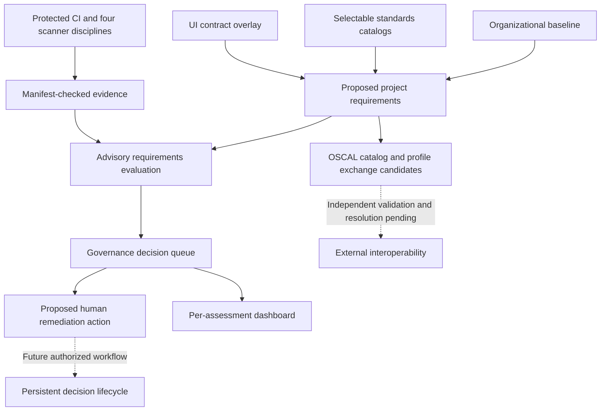

# Security Governance Management Application (SGMA)
## Enterprise Security Governance and Automation

**Active development — November 19, 2026.** A working local, advisory cybersecurity governance prototype connecting DevSecOps evidence, organizational security policy, selectable industry-standard requirements, configurable contractual obligations and human-controlled governance decisions. OSCAL exchange is implemented at the candidate artifact level; independent interoperability and production acceptance remain open.

[Portfolio home](https://github.com/matthewkniskern-source/Portfolio-Artifacts) · [Development branch](https://github.com/matthewkniskern-source/Portfolio-Artifacts/tree/develop/enterprise-security-automation) · [Verified CI run #39](https://github.com/matthewkniskern-source/Portfolio-Artifacts/actions/runs/44583519480) · [Current QA/QC record #22](https://github.com/matthewkniskern-source/Portfolio-Artifacts/issues/22)

## Purpose and scope

SGMA is designed as a contract-centric, framework-agnostic and vendor-neutral operational information system. It preserves the source and revision of each obligation while connecting technical evidence to multiple affected requirements and consolidating remediation work. Automation evaluates and recommends; it does not independently approve policy, accept risk, certify compliance or authorize deployment.

## Implementation status

| Capability | Current state |
|---|---|
| DevSecOps pipeline | Four scanner disciplines: Trivy IaC/SCA, Semgrep SAST, Gitleaks current-tree secret detection; Terraform static validation |
| Protected integration | Pull requests, required validation and resolved conversations; two historical scoped exceptions; no independent separation of duties claimed |
| Evidence ingestion | Complete CI ZIP import, manifest checks, scanner coverage derivation and declared source references; unauthenticated provenance |
| Versioned requirements | Mandatory synthetic organizational baseline, selectable registry revisions, protected selected rows, advisory ad hoc requirements |
| Standard templates | Three bundled NIST catalogs: SP 800-171 Rev. 3 (130 entries), CSF 2.0 (219), SSDF (61); source OSCAL v1.2.2 |
| OT/ICS requirements | 20 selectable SGMA-authored, NIST SP 800-82 Rev. 3-informed candidate objectives; manual review, advisory references and evidence expectations; official overlay and asset-context implementation pending |
| Contract authoring | Browser-based draft requirements, source clauses, applicability, evidence, descriptive deadlines, manual/automated/hybrid methods and explicit scanner rules |
| Change and control mapping | Revision comparison and advisory mapping proposals implemented; integrated browser acceptance and approved mapping graph pending |
| OSCAL exchange | Catalog inspection, candidate catalogs/profiles, multi-source ZIP with manifest, version-specific schema adapter and offline provisioning utility; official schemas and independent resolution pending |
| Governance decision matrix | Within-evidence-document occurrence consolidation, many-requirement associations, proposed owner/action/deadline; legacy requirement-level fallback |
| Dashboard | Per-assessment counts and decision table; no organization-wide or role-specific reporting yet |
| Application and persistence | Flask, Waitress, SQLAlchemy, PyMySQL; opt-in project-scoped draft API and role checks; SQLite tests, no MySQL runtime validation |
| Security and deployment | Full authentication/RBAC, migrations, independent evidence authenticity, red-team closeout and deployment acceptance outstanding |

## Architecture



The internal SGMA domain model remains separate from OSCAL exchange adapters. OSCAL catalogs retain structured source content; selection and projection are not compliance determinations. Standard-derived requirements currently route to manual review unless separately mapped through reviewed assessment logic. Contract-specific scanner rules retain stricter organizational and existing contractual requirements. Original source statements, source identifiers and revision fingerprints support traceability; reserialized JSON is not byte-identical to its original source.

## Verified milestones and evidence

| Record | Result |
|---|---|
| [Issue #8](https://github.com/matthewkniskern-source/Portfolio-Artifacts/issues/8) | Control effectiveness tests SCV-001–004, including initial unexpected results and remediation |
| [PR #11](https://github.com/matthewkniskern-source/Portfolio-Artifacts/pull/11) | Unified security gate and advisory requirements workbench |
| [Issue #12](https://github.com/matthewkniskern-source/Portfolio-Artifacts/issues/12) | UAT-001–004 |
| [PR #13](https://github.com/matthewkniskern-source/Portfolio-Artifacts/pull/13) | Application foundation, 57 automated tests |
| [PR #16](https://github.com/matthewkniskern-source/Portfolio-Artifacts/pull/16) | Evidence verification, 61 tests |
| [PR #17](https://github.com/matthewkniskern-source/Portfolio-Artifacts/pull/17), [Issue #18](https://github.com/matthewkniskern-source/Portfolio-Artifacts/issues/18) | Evidence workspace, 68 tests; UAT-005–009 |
| [PR #19](https://github.com/matthewkniskern-source/Portfolio-Artifacts/pull/19), [Issue #20](https://github.com/matthewkniskern-source/Portfolio-Artifacts/issues/20) | Versioned requirements registry, 77 tests; UAT-010–016 |
| [PR #21](https://github.com/matthewkniskern-source/Portfolio-Artifacts/pull/21), [CI #39](https://github.com/matthewkniskern-source/Portfolio-Artifacts/actions/runs/44583519480) | Integrated roadmap 02–10; 95/95 tests including 18 new tests; merged at `da120534` |
| [Issue #22](https://github.com/matthewkniskern-source/Portfolio-Artifacts/issues/22) | QA-02A–L: 12 functional objectives passed within tested scope; consolidated acceptance remains open |

CI #39 verified two historical exceptions and returned EXCEPTION APPROVED / REVIEW REQUIRED, not an unconditional security or deployment approval. Local CLI regression output and post-merge CI have not been independently verified in the recorded campaign.

### Integrated demonstration results

Historical [negative CI run](https://github.com/matthewkniskern-source/Portfolio-Artifacts/actions/runs/44153268306) assessed against a synthetic project with organizational, existing contract, two selected NIST overlays and a new hybrid contract obligation:

- 15 requirement assessments (6 automated, 9 manual); 5 gaps, 9 reviews, 1 residual risk.
- 13 governance records (3 technical gaps, 9 reviews, 1 residual risk).
- One PyYAML vulnerability occurrence associated with three independently retained obligations.
- Effective SCA threshold remains LOW; original CI BLOCK retained.
- 6/6 OSCAL bundle manifest checks and 5/5 occurrence identifiers reproduced from recorded evidence fingerprint and indices.
- 40% fewer technical gap records in this scenario (5 to 3); 13.3% fewer overall records (15 to 13). No measured labor savings claimed.

Detailed artifact hashes, limitations and acceptance observations: [Issue #22](https://github.com/matthewkniskern-source/Portfolio-Artifacts/issues/22). Historical [evidence register](evidence/historical-validation-register.json), [clean CI](https://github.com/matthewkniskern-source/Portfolio-Artifacts/actions/runs/44152446196), [remediation CI](https://github.com/matthewkniskern-source/Portfolio-Artifacts/actions/runs/44153605369). CI artifacts have finite retention; raw historical archives and operator exports are retained offline, not published here.

## Run locally — no database required

From the repository root, with an isolated Python virtual environment activated:

```bash
python -m pip install -r Enterprise-Security-Automation/sgma/requirements.txt
python -m unittest discover -s Enterprise-Security-Automation/tests -v
python Enterprise-Security-Automation/sgma/app.py preview
```

Open http://127.0.0.1:8765 for the main assessment workbench or http://127.0.0.1:8765/roadmap for standards, contracts, OSCAL and decision workflows. Preview binds locally and does not require database or cloud initialization.

1. Compose/export a registry-bound project proposal in the main workspace.
2. In the roadmap workspace, select and stage standards controls; author and validate a contract draft.
3. Compose a new project revision using the exported base proposal; export native proposal and OSCAL candidate bundle.
4. Import the native proposal in the main workspace, import a complete CI **security evidence ZIP** (not the OSCAL exchange ZIP), evaluate and export the assessment.
5. Import the assessment into the roadmap decision queue and generate an advisory action draft.

The original stateless workbench remains available via `python Enterprise-Security-Automation/governance/workbench.py`. CI: [workflow](../.github/workflows/enterprise-security-baseline.yml). Terraform validation is static; no apply workflow.

## OSCAL interoperability

The pinned [NIST OSCAL Content v1.5.0](https://github.com/usnistgov/oscal-content/releases/tag/v1.5.0) catalogs are retained in `interoperability/oscal/catalogs/`, with upstream licensing notice. Generated profiles target OSCAL 1.2.3. Source versions remain distinct; no automatic remote reference resolution occurs. Official schema assets must be separately provisioned and checked against pinned hashes; missing assets are explicitly reported. Schema conformance, semantic validation, independent profile resolution and cross-tool exchange have not yet been established. Additional lifecycle models currently have inspection adapters, not complete generation or operational exchange. SGMA-specific properties may not be interpreted by other applications.

See [revised architecture, schema provisioning and QA/QC checklist](documentation/sgma-roadmap-02-10.md).

## Authoritative source library and common control intelligence

Open http://127.0.0.1:8765/controls for source-scoped navigation and direct relationship review. The prototype indexes the existing 410 complete NIST catalog entries, a pinned exact 221-entry SP 800-53/53A Rev. 5.2.0 reference extract and 20 SGMA-authored OT candidates (651 projected entries, 37 unreviewed related relationships). The full 800-53 catalog is not onboarded as an OSCAL template; the read-only extract retains original control subtrees and source metadata, with an offline comparison utility. Official 800-82 overlays, licensed IEC content, authorized equivalence/evidence reuse and actual project impact are not yet implemented. New tests await verification. See [source provenance, graph design and acceptance](documentation/sgma-control-intelligence.md).

## OT Intelligence Center

Open http://127.0.0.1:8765/ot for context-driven candidate discovery, searchable technology-tagged requirements, source references, proposed contract clauses, traceability and acceptance checklists. This is an original advisory implementation informed by commercial design patterns, not a benchmark of commercial performance. See [OT intelligence architecture and acceptance](documentation/sgma-ot-intelligence.md). Five new tests await verification. No authoritative applicability, licensed content or live assessment is implied.

## OT/ICS extension

See [OT requirements scope and test plan](documentation/sgma-ot-requirements.md). The selectable OT candidate is not an official NIST overlay. It introduces no active OT scanning or authorization, and retains the existing baseline and scanner rules. New tests await CI and browser verification.

## Remaining engineering and acceptance

- Contract revision comparison QA, approved common control mappings and impact analysis, parameter configuration and additional reviewed/licensed templates.
- Official schema provisioning and validation, independent OSCAL resolver and cross-tool round trip, SSP/AP/AR/POA&M lifecycle generation.
- Persistent governance action lifecycle, structured deadlines, role-specific and organization-wide reporting.
- Full application authentication and scoped authorization, MySQL migrations/runtime and container validation.
- UI/UX remediation, deferred red-team findings, independent CI enforcement, authenticated evidence and final security acceptance.

Synthetic data only. Do not commit credentials, real contracts, sensitive findings or state. No live AWS infrastructure, public application deployment, compliance certification or automated risk acceptance. Formal acceptance remains open.

[Revised roadmap](documentation/sgma-roadmap-02-10.md) · [Earlier roadmap](documentation/roadmap.md) · [Local setup boundaries](documentation/sgma-local.md) · [Hardening notes](documentation/hardening.md) · [Scanner scope](documentation/expanded-scanning.md) · [Legacy integration](governance/legacy-integration.md)
