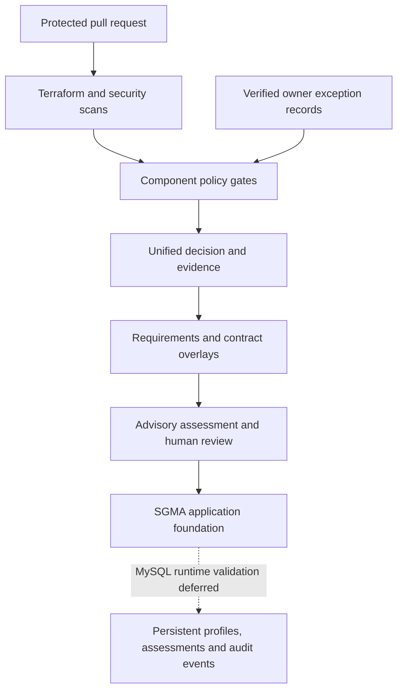

# Security Governance Management Application (SGMA)
## Enterprise Security Governance and Automation

**Active development — November 17, 2026.** Working static DevSecOps and advisory governance prototype with a locally user-tested requirements workbench and a newly integrated database-oriented application foundation. MySQL setup and testing are intentionally deferred. No live AWS infrastructure, public application deployment, compliance certification or automated risk acceptance.

[Portfolio home](https://github.com/matthewkniskern-source/Portfolio-Artifacts) · [Active development branch](https://github.com/matthewkniskern-source/Portfolio-Artifacts/tree/develop/enterprise-security-automation) · [Latest verified pipeline](https://github.com/matthewkniskern-source/Portfolio-Artifacts/actions/runs/44163139855)

## Purpose and scope
SGMA connects technical security findings to organizational and contractual obligations, evidence, documented decisions and accountable change management. It is a vendor-neutral synthetic lab demonstrating security engineering and governance together. Human authority remains separate from automated evaluation.

## Verified milestones
| Capability | Implementation and validation |
|---|---|
| Infrastructure as code | Terraform configuration for AWS evidence and logging storage validated statically; no resources provisioned |
| DevSecOps | Four security disciplines: Trivy IaC, Semgrep SAST, Trivy SCA and Gitleaks current-tree secret detection |
| Protected integration | GitHub ruleset 27481934 requires pull requests, current passing validation and resolved conversations; blocks branch deletion and force pushes |
| Human governance | Two scoped S3 exceptions, exact-head owner attestations in PR #3; expire 2027-02-15; no independent separation of duties claimed |
| Tests of control effectiveness | SCV-001–004 complete within defined scope; PRs #5–7 closed without merging; issue #8 documents initial unexpected results and remediation |
| Hardened pipeline | Unified security decision, mandatory component outcomes, report hashes, pinned action refs, updated Trivy, 90-day artifact retention; hardening originally PR #9, integrated via PR #11 |
| Negative regression | REG-001 blocked all three intended synthetic findings while preserving two existing exceptions. Remediation passed. |
| Requirements engine | Baseline plus synthetic contractual overlays, stricter-threshold precedence, manual applicability, residual risk and gap assessments; advisory only |
| Local browser workbench | UAT-001–004 accepted in issue #12: precedence, clean and negative CI evidence assessments, proposal and assessment exports |
| SGMA application foundation | PR #13 merged; Flask, Waitress, SQLAlchemy, PyMySQL, versioned storage model, audit events, baseline guard and localhost defaults; 57 automated tests passed (storage tests use SQLite) |
| MySQL runtime | Schema/bootstrap and connection code implemented; no local schema creation or MySQL integration validation yet |
| Container packaging | Non-root Dockerfile and environment configuration present; build/runtime not validated |
| Operational identity and deployment | Authentication, RBAC, decision workflows, authoritative evidence verification, migrations, private evidence storage and cloud deployment outstanding |

## How the system works


The original stateless workbench is functional locally. The integrated SGMA service adds a storage model and API routes for saving and loading assessments. MySQL remains the intended local database; SQLite is the automated test backend. Proposed requirements do not modify the CI policy or grant deployment authority.

## Evidence and independent reproducibility
| Record | Evidence |
|---|---|
| Current integrated application | [PR #13](https://github.com/matthewkniskern-source/Portfolio-Artifacts/pull/13), merge commit `61895cb`, [run 44163139855](https://github.com/matthewkniskern-source/Portfolio-Artifacts/actions/runs/44163139855): 57/57 tests; expanded PASS; two approvals verified; unified EXCEPTION APPROVED; requirements REVIEW REQUIRED |
| Initial exception lifecycle | [Issue #2](https://github.com/matthewkniskern-source/Portfolio-Artifacts/issues/2) |
| Control effectiveness campaign | [Issue #8](https://github.com/matthewkniskern-source/Portfolio-Artifacts/issues/8); initial false-negative synthetic secret pattern and advisory medium dependency findings retained |
| Hardened regression | [Clean run](https://github.com/matthewkniskern-source/Portfolio-Artifacts/actions/runs/44152446196), [negative run](https://github.com/matthewkniskern-source/Portfolio-Artifacts/actions/runs/44153268306), [remediation run](https://github.com/matthewkniskern-source/Portfolio-Artifacts/actions/runs/44153605369) |
| Requirements implementation | [PR #11](https://github.com/matthewkniskern-source/Portfolio-Artifacts/pull/11) |
| Local browser validation | [Issue #12](https://github.com/matthewkniskern-source/Portfolio-Artifacts/issues/12) — four accepted UAT cases, operator screenshots and JSON exports |
| Historical evidence register | [Register](evidence/historical-validation-register.json) — ten historical artifacts, recorded digests, normalized observations |

Current artifact: 14364945754, recorded SHA-256 `91ec81d64ddef23e9b24ba701edb59f126a72ba338dd58e492ff18f2689885e2`, expires 2027-02-15. CI reports have finite retention; historical raw archives were exported offline, not published in the repository. Hashes alone do not authenticate evidence or make records immutable.

## Requirements library (proposed integration)
The repository-controlled synthetic registry is `governance/library/registry.json`. The active organizational baseline is ORG-BASE@1.0; contract A has historical revision 1.0 (MEDIUM SCA) and demonstration successor 1.1 (LOW SCA). Select a revision in the preview workspace and compose a new proposal, using a new project revision when changing requirements. Composition replaces current requirement rows, including ad hoc additions. Selected registry entries and their SHA-256 fingerprints are preserved in assessment exports; server-side assessment rejects changes to selected rows or references. Ad hoc additions and legacy proposals remain unapproved. Registry matching does not establish contractual applicability, independent approval, signed provenance or compliance. No actual regulatory clauses or customer contracts are included. Library changes require repository review; no write API. Formal registry migration and historical baseline replay are future work. Browser UAT and CI results must be recorded separately.

## Evidence workspace preview
Install the pinned SGMA dependencies in an isolated virtual environment, then run `python Enterprise-Security-Automation/sgma/app.py preview` from the repository root. Open http://127.0.0.1:8765, choose a complete CI evidence ZIP, and evaluate the proposal. The server verifies the archive on every assessment, derives scanner coverage and returns declared source identifiers and integrity status. Manifest matches do not establish authenticated provenance or authoritative project association. Archive assessments are export-only; preview disables database operations. Legacy JSON assessment remains explicitly user-declared. Historical archive compatibility and local browser UAT remain outstanding until recorded. No cloud or MySQL initialization required.

## Run locally — no database required
Clone the active development branch, then from the repository root run:
```bash
python Enterprise-Security-Automation/governance/workbench.py
```
Open http://127.0.0.1:8765. Use the synthetic sample profile, add overlays, import a unified-decision.json from a verified run, manually confirm completed scanners and evaluate/export. See [workbench guide](documentation/requirements-workbench.md).

For automated tests, install the application dependencies in an isolated virtual environment, then:
```bash
python -m pip install -r Enterprise-Security-Automation/sgma/requirements.txt
python -m unittest discover -s Enterprise-Security-Automation/tests -v
```
CI workflow: [enterprise-security-baseline.yml](../.github/workflows/enterprise-security-baseline.yml). Static Terraform validation uses `terraform init -backend=false` and `terraform validate` in infrastructure/aws; no apply workflow exists.

## Application architecture and future deployment
Browser HTML/CSS/JavaScript → Flask/Waitress → requirements engine and SQLAlchemy → MySQL (planned runtime). The initial schema contains projects, profile revisions, assessments and audit events. Storage is tested in SQLite; MySQL compatibility and persistence remain unverified. Environment settings and non-root container packaging support future portability, not production readiness.

Developer reference: [SGMA local setup and deployment boundaries](documentation/sgma-local.md). Database setup is deferred; the existing stateless workbench remains available.

## Limitations and next milestones
- Synthetic data only. Do not commit credentials, state, real contracts or sensitive findings.
- Automated results are not compliance certification. Imported evidence and local operator identity remain unverified. The workbench is advisory; its imports do not authorize CI policy changes.
- Required checks do not independently protect their own workflow from authorized edits. Scanner coverage is limited, and no insecure merge was attempted. One Node runtime deprecation warning remains.
- Local MySQL initialization and runtime testing are paused. Future milestones: authenticated evidence ingestion, authoritative baseline registry and revision workflow, actionable decision matrix, persistent storage validation, authentication/RBAC, dashboard, private evidence retention and authorized cloud deployment. No database or cloud provisioning is required for the existing demonstration.

See [roadmap](documentation/roadmap.md), [hardening notes](documentation/hardening.md), [scanner scope](documentation/expanded-scanning.md) and [legacy integration](governance/legacy-integration.md).
