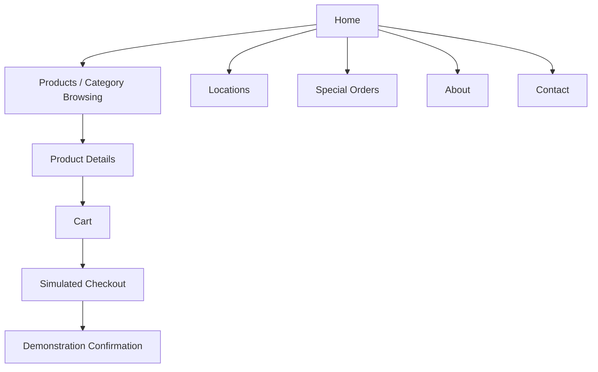

# Website Sitemap — Implemented Academic Demo

This is a navigation view of the static browser prototype, not a claim of real account or inventory services.

The corresponding HTML pages are maintained in [Implementation/Academic Website](../../Implementation/Academic%20Website/). The fuller design rationale and proposed account/administrative pathways appear in [Information Architecture](information%20architecture.md). Mermaid is used for an exportable diagram; no dynamic checkout service is represented here.
